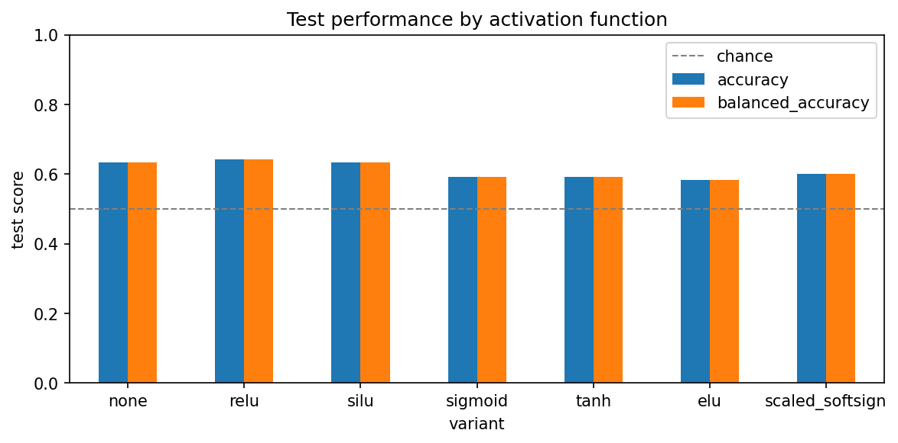
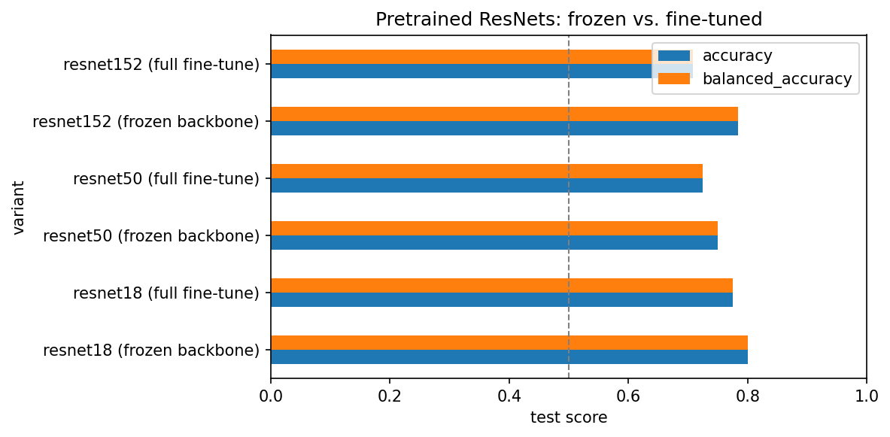

# Children vs. Adults: Image Classification with CNNs

[](https://colab.research.google.com/github/IFDES/CNN-children-vs-adults/blob/main/children_vs_adults_cnn.ipynb)

A PyTorch project that classifies photos as **child** or **adult**, used as a testbed for three questions that come up in most real CNN work:

1. **Activation functions:** how much does the non-linearity matter in a deep CNN, and can a custom one compete?
2. **Transfer learning:** how do pretrained ResNet-18/50/152 compare, and does freezing the backbone help on a tiny dataset?
3. **Class imbalance:** what happens when one class is under-represented, and does a `WeightedRandomSampler` help?

Everything lives in one notebook: [`children_vs_adults_cnn.ipynb`](children_vs_adults_cnn.ipynb).

## Key results

Test set: 120 images (60 per class). With a test set this small, the 95% interval on any accuracy is roughly ±9 points, so only large gaps are meaningful.

**Transfer learning beat training from scratch by about 13 points.**

| Model | Frozen backbone | Full fine-tune |
|---|---|---|
| ResNet-18 | **80.0%** | **80.0%** |
| ResNet-50 | 75.0% | 61.7% |
| ResNet-152 | 78.3% | 70.8% |

Freezing helped the deeper networks. Fine-tuned runs overfit and had unstable validation loss (learning rate 1e-3 is likely too aggressive for fine-tuning).

**Activation functions** (custom 6-block CNN trained from scratch, activation in the fully-connected head):

| Activation | Test accuracy |
|---|---|
| None (baseline) | 66.7% |
| Tanh | 62.5% |
| Sigmoid | 61.7% |
| SiLU | 60.8% |
| ReLU | 60.0% |
| Scaled softsign (custom) | 56.7% |
| ELU | 55.8% |

Everything from scratch landed within noise of each other (56–67%), well below the pretrained models. ELU and SiLU barely trained and were biased toward predicting "adult".




**Class imbalance** (training split ~4:1 adults to children): _TODO: add accuracy, balanced accuracy and minority-class recall with and without `WeightedRandomSampler`._

## What's in the notebook

- **Data pipeline:** `ImageFolder` + 80/20 train/validation split (seeded), optional `WeightedRandomSampler`.
- **Training utilities:** one shared `fit` / `evaluate` for every experiment (Adam, `BCEWithLogitsLoss`, best-validation-epoch checkpoint, per-class reports and balanced accuracy).
- **`DeepCNN`:** a VGG-style network (6 conv blocks + 3 dropout/FC layers, ~229M parameters) with a pluggable activation.
- **Custom activation:** `ScaledSoftsign`, `f(x) = x / (1 + α|x|)`, implemented from scratch.
- **ResNet transfer learning:** frozen-backbone vs. full fine-tune for ResNet-18/50/152.
- **Imbalance experiment:** a small CNN trained with and without weighted sampling.

## Run it yourself

1. Download the data from Kaggle: [Children vs. Adults Images](https://www.kaggle.com/datasets/die9origephit/children-vs-adults-images).
2. Arrange it as `balanced_data/{train,test}/{adults,children}/` (and the same for `imbalanced_data/`, with the children class downsampled to roughly a 4:1 ratio).
3. Set `DATA_ROOT` in the first code cell.
4. Open in Colab with a GPU runtime and run all cells. Or locally:

```bash
pip install -r requirements.txt
jupyter notebook children_vs_adults_cnn.ipynb
```

The dataset is not included in this repository.

## Next steps

- Global average pooling in the head: over 89% of `DeepCNN`'s parameters sit in its first fully-connected layer.
- Data augmentation (flips, rotation, colour jitter, noise).
- A lower learning rate for fine-tuning, and ImageNet normalisation for the pretrained models.
- Multiple seeds with mean ± std.

## Credits

Dataset: [Children vs. Adults Images](https://www.kaggle.com/datasets/die9origephit/children-vs-adults-images) on Kaggle. This started as a course project for CMPUT 466/566 at the University of Alberta and was restructured and extended here.
